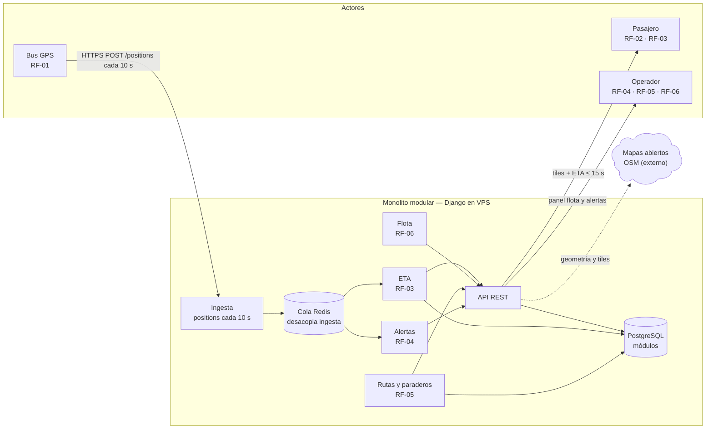
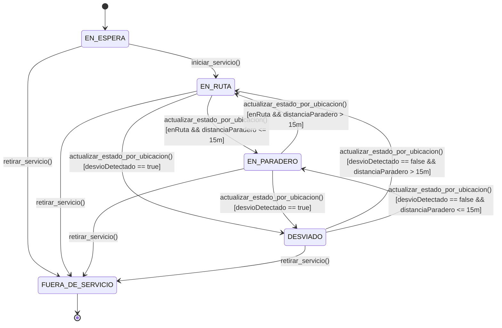
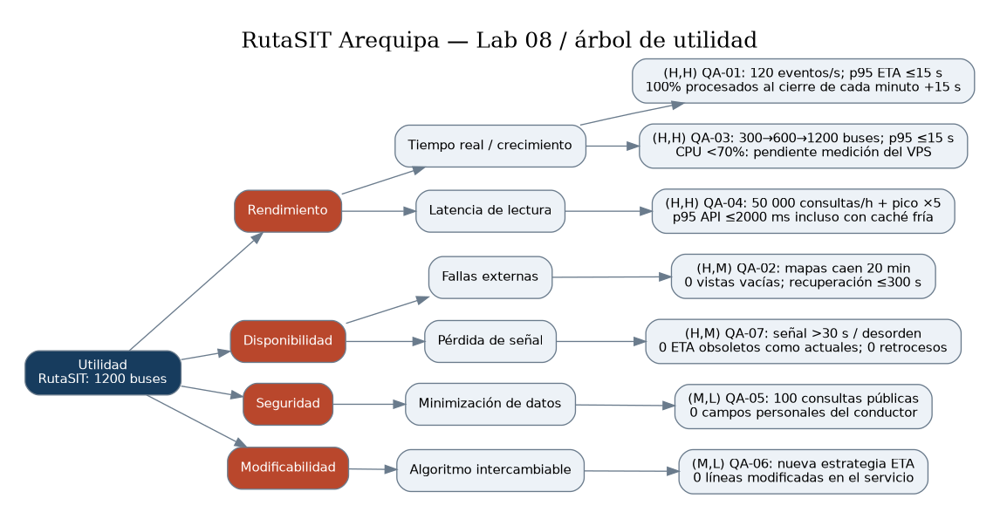

# RutaSIT Arequipa — Laboratorio 04: Fundamentos de arquitectura de software

`Construcción de Software · EPIS-UNSA · 2026-B · Grupo B`

## Integrantes

| Nombre | Rol en el laboratorio |
|--------|----------------------|
| Layme Salas, Rodrigo Fabricio | Diagramador (Mermaid / despliegue) |
| Auccacusi Conde, Brayan Carlos | Redactor de ADR |
| Castillo Lazo, Rodrigo Zarun | Verificador de IA y bitácora |

## Caso

**RutaSIT Arequipa** (caso N.º 6): seguimiento en tiempo real de los buses del
SIT de Arequipa. El pasajero ve los buses en un mapa y consulta el ETA a su
paradero; el operador recibe alertas y administra rutas. Atributo crítico:
**rendimiento en tiempo real — 300 buses envían posición cada 10 s y el ETA se
actualiza en ≤ 15 s** (30 eventos/s).

## Arquitectura elegida

Monolito modular (alternativa C, 4,20) — ver
[`docs/architecture/matriz-decision.md`](docs/architecture/matriz-decision.md) y
[ADR-001](docs/architecture/adr/001-estilo-arquitectonico.md).



Render: [`docs/architecture/diagramas/img/arquitectura.png`](docs/architecture/diagramas/img/arquitectura.png).

## Decisiones arquitectónicas

- [ADR-001](docs/architecture/adr/001-estilo-arquitectonico.md): monolito modular + cola Redis.
- [ADR-002](docs/architecture/adr/002-postgres-vs-mongo.md): PostgreSQL con esquemas por módulo.
- [ADR-003](docs/architecture/adr/003-rest-vs-cola.md): REST al borde + cola Redis interna.

## Diagramas

| Vista | Fuente | Imagen |
|-------|--------|--------|
| Arquitectura (Mermaid, E3) | `diagramas/arquitectura.mmd` | `diagramas/img/arquitectura.png` (generada con `mermaid-cli`) |
| Alternativa descartada (PlantUML, E5) | `diagramas/alternativa.puml` | `diagramas/img/alternativa.png` |
| Despliegue (Python Diagrams, E6) | `diagramas/despliegue.py` | `diagramas/img/despliegue.png` |
| Matriz (matplotlib, E2) | `diagramas/matriz_decision.py` | `diagramas/img/matriz-decision.png` |

> Nota (Plan B de la guía): esta máquina no tiene Graphviz (`dot`), por lo que
> el `.puml` y el `despliegue.py` (canonical, con `Cluster` + `Edge(label=...)`)
> se versionan como fuente y sus PNG se generaron localmente con matplotlib con
> la misma topología. Para regenerar los originales: `mmdc` para el `.mmd`,
> `java -jar plantuml.jar` (requiere Graphviz) para el `.puml`, y
> `uv run --with diagrams python despliegue.py` (requiere Graphviz).

## Reflexión sobre el uso de la IA

La IA (Muse Spark 1.3 con harness Opencode en esta fase) aceleró la redacción de
alternativas, la crítica adversarial y el esqueleto de los ADR. Pero propuso
sobredimensionar (Kafka/K8s para 30 eventos/s) e inventó supuestos (API de mapas
gratis), por lo que cada afirmación se verificó con cálculo y documentación
oficial antes de decidir. Aprendimos a pedir medidas numéricas, a desconfiar de
recomendaciones sin restricción de plazo/equipo y a registrar todo en la
[bitácora](docs/architecture/bitacora-ia.md).

## Diseño UML (Lab 05)

Laboratorio 05 de Construcción de Software: modelado de HU-06 para **RutaSIT Arequipa**, actualización de telemetría GPS, cálculo de ETA y alertas de desvío. Las fuentes editables están en [`lab05/`](lab05/README.md).

### Máquina de estados del Bus (E3)



### Diagramas renderizados y fuentes

| Entregable | Imagen en `lab05/img/` | Fuente |
|---|---|---|
| E1: clases | [SVG](lab05/img/diagrama_clases.svg) · [PNG](lab05/img/diagrama_clases.png) | [PlantUML](lab05/diagrama_clases.puml) |
| E2: secuencia | [SVG](lab05/img/diagrama_secuencia.svg) · [PNG](lab05/img/diagrama_secuencia.png) | [PlantUML](lab05/diagrama_secuencia.puml) |
| E3: estados | [SVG](lab05/img/diagrama_estados.svg) · [PNG](lab05/img/diagrama_estados.png) | [Mermaid](lab05/diagrama_estados.mmd) |
| E4: actividades | [SVG](lab05/img/diagrama_actividades.svg) · [PNG](lab05/img/diagrama_actividades.png) | [PlantUML](lab05/diagrama_actividades.puml) |
| E5: paquetes | [SVG](lab05/img/diagrama_paquetes.svg) · [PNG](lab05/img/diagrama_paquetes.png) | [PlantUML](lab05/diagrama_paquetes.puml) |

Más archivos: [historia HU-06](lab05/historia.md), [round-trip](lab05/round-trip.md), [matriz C1-C5](lab05/consistencia.md), [bitácora IA](lab05/bitacora-ia.md) y [esqueleto Python](lab05/src/rutasit/README.md).

### Regenerar diagramas y verificar código

Desde la raíz del repositorio, con Java y PlantUML disponibles:

```bash
cd lab05
java -DPLANTUML_LIMIT_SIZE=8192 -jar plantuml.jar -tsvg -o img \
  diagrama_clases.puml diagrama_secuencia.puml \
  diagrama_actividades.puml diagrama_paquetes.puml
npx --yes @mermaid-js/mermaid-cli -i diagrama_estados.mmd -o img/diagrama_estados.svg -b white
java -DPLANTUML_LIMIT_SIZE=8192 -jar plantuml.jar -tpng -o img \
  diagrama_clases.puml diagrama_secuencia.puml \
  diagrama_actividades.puml diagrama_paquetes.puml
npx --yes @mermaid-js/mermaid-cli -i diagrama_estados.mmd -o img/diagrama_estados.png -b white
PYTHONPATH=src python -m unittest discover -s tests -v
```

### Commits sugeridos por entregable

Ejecutar cada commit después de revisar su diff; los avances se mantendrán separados hasta la integración final.

| E | Mensaje de commit |
|---|---|
| E1 | `E1: diagrama de clases` |
| E2 | `E2: secuencia` |
| E3 | `E3: estados` |
| E4 | `E4: diagrama de actividades` |
| E5 | `E5: diagrama de paquetes` |
| E6 | `E6: esqueleto Python y round-trip` |
| E7 | `E7: consistencia C1-C5 y bitácora IA` |
| E8 | `E8: README y flujo de entrega` |

Comandos para registrar los ocho avances como commits separados:

```bash
git add lab05/historia.md lab05/diagrama_clases.puml
git add lab05/img/diagrama_clases.png lab05/img/diagrama_clases.svg
git commit -m "E1: diagrama de clases"
git add lab05/diagrama_secuencia.puml lab05/img/diagrama_secuencia.png lab05/img/diagrama_secuencia.svg
git commit -m "E2: secuencia"
git add lab05/diagrama_estados.mmd lab05/img/diagrama_estados.png lab05/img/diagrama_estados.svg
git commit -m "E3: estados"
git add lab05/diagrama_actividades.puml lab05/img/diagrama_actividades.png lab05/img/diagrama_actividades.svg
git commit -m "E4: diagrama de actividades"
git add lab05/diagrama_paquetes.puml lab05/img/diagrama_paquetes.png lab05/img/diagrama_paquetes.svg
git commit -m "E5: diagrama de paquetes"
git add lab05/pyproject.toml lab05/src/rutasit lab05/tests lab05/round-trip.md lab05/roundtrip
git commit -m "E6: esqueleto Python y round-trip"
git add lab05/consistencia.md lab05/bitacora-ia.md
git commit -m "E7: consistencia C1-C5 y bitácora IA"
git add README.md lab05/README.md
git commit -m "E8: README y flujo de entrega"
```

### Pull Request cruzado y tag de entrega

Flujo de rama/PR de ejemplo para un entregable; asignar `$REVISOR` a otro integrante, nunca al autor del PR:

```bash
git switch -c feat/lab05-e1-clases
git add lab05/historia.md lab05/diagrama_clases.puml lab05/img/diagrama_clases.png lab05/img/diagrama_clases.svg
git commit -m "E1: diagrama de clases"
git push -u origin feat/lab05-e1-clases
REVISOR="usuario-github-del-revisor"
gh pr create --base master --head feat/lab05-e1-clases --title "E1: diagrama de clases" --body "Revisión cruzada de HU-06 y modelo de dominio."
gh pr edit --add-reviewer "$REVISOR"
# El revisor, en su sesión, comprueba el diff y las pruebas y, si corresponde:
gh pr checkout feat/lab05-e1-clases
gh pr review feat/lab05-e1-clases --approve
# Integrar el PR aprobado en master desde GitHub.
```

1. Cada integrante trabaja en una rama `feat/lab05-eN-*`, publica la rama y abre un PR a `master` con el mensaje del entregable.
2. Solicitar revisión cruzada: Layme revisa un PR de Brayan, Brayan uno de Castillo y Castillo uno de Layme. Nadie aprueba su propio PR; integrar tras revisión de diagramas, C1-C5 y pruebas.
3. Después de integrar y validar todos los entregables:

```bash
git switch master
git pull --ff-only origin master
git tag v0.5-diseno
git push origin v0.5-diseno
```

## Patrones de diseño (Lab 07)

Refactor de `consultar_seguimiento` hacia 6 patrones GoF (ver `lab07/`).

| Olor | Patrón | Prueba |
|---|---|---|
| `if/elif` ETA | Strategy + Factory | `test_open_closed_nuevo_algoritmo_sin_modificar_servicio` |
| SDK GPS distintos | Adapter | `test_adapter_unifica_gps` |
| Reintentos duplicados | Decorator | `test_decorator_reintentos_solo_timeout` |
| Condicionales estado | State | `test_state_impide_transiciones_invalidas` |
| Avisos a mano | Observer | `test_observer_nuevo_suscriptor_sin_tocar_servicio` |
| LLM no confiable | Strategy + Decorator + Chain | `test_chain_bloquea_salida_invalida` |

Métricas: consultar C(18)→A(5), promedio B(7.0)→A(1.69), SLOC 89→239. Pruebas: `30 passed, 1 xfailed`. ADR: `lab07/docs/architecture/adr/005-patrones-de-diseno.md`.

## Diseño de la arquitectura (Lab 08)

[](https://github.com/F4brici0L4yme/cs-2026b-lab04-grupo-b/actions/workflows/fitness.yml)

Evolución de RutaSIT a **1200 buses** y **50 000 consultas de ETA en hora punta**,
mediante tres iteraciones ADD. [Laboratorio completo](lab08/README.md).



| Iteración | Escenario | Táctica | Evidencia (simulación/prototipo) | ¿Cumple? |
|---|---|---|---|---|
| 1 | QA-01/03 | Reducir trabajo por evento y precargar geometría | p95 ráfaga 99,919→7,616 s | QA-01 sí bajo supuestos; CPU pendiente |
| 2 | QA-04/07 | Read model indexado + caché TTL 2 s | p95 pico 130,788 ms; caché fría 256,663 ms | Sí bajo supuestos; validar servicio real |
| 3 | QA-02 | Circuit breaker + respuesta textual | 0 pantallas vacías; 3600→42 llamadas en caída | Sí en prototipo secuencial |

- [ADR-006](lab08/docs/architecture/adr/006-ingesta.md),
  [ADR-007](lab08/docs/architecture/adr/007-consultas-eta.md),
  [ADR-008](lab08/docs/architecture/adr/008-disponibilidad-mapas.md).
- [C4 actualizado](lab08/docs/architecture/c4/README.md),
  [ATAM-lite y riesgos](lab08/docs/architecture/atam-lite.md),
  [evidencia ejecutada](lab08/evidencias/resultados.md).
- [Fuente versionada del informe](lab08/docs/informe.md). El PDF y el DOCX se
  generan localmente en `lab08/informe/` (ignorado por Git); ver
  [instrucciones](lab08/README.md#ejecutar-desde-la-raíz-del-repositorio).
- Verificación local: 24 pruebas y 2 contratos aprobados. El badge refleja el
  estado remoto cuando se publique el workflow. [Pendientes de entrega](lab08/entrega.md):
  intercambio E3, PR individuales revisados, Action verde y `v0.8-arquitectura`.
