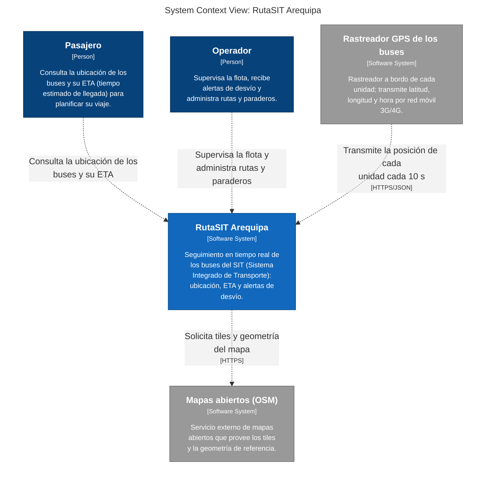

# Laboratorio 06: modelo C4 de RutaSIT Arequipa

Modelo C4 del seguimiento en tiempo real de los buses del SIT de Arequipa, descrito una sola
vez en Structurizr DSL y derivado en cinco vistas coherentes. Continúa los artefactos de los
Laboratorios 04 y 05 (misma fuente de contenido).

## Arquitectura C4 (Lab 06)

Diagrama de contexto en Mermaid, copiado de
[`docs/architecture/c4/export/structurizr-Contexto.mmd`](docs/architecture/c4/export/structurizr-Contexto.mmd)
tal como lo genera la CLI y lo renderiza GitHub:



### Vistas del modelo

| # | Vista | Imagen | Origen |
|---|---|---|---|
| 1 | Contexto (nivel 1) | [structurizr-Contexto.png](docs/architecture/c4/img/structurizr-Contexto.png) | `workspace.dsl` |
| 2 | Contenedores (nivel 2) | [structurizr-Contenedores.png](docs/architecture/c4/img/structurizr-Contenedores.png) | `workspace.dsl` |
| 3 | Componentes (nivel 3) | [structurizr-Componentes.png](docs/architecture/c4/img/structurizr-Componentes.png) | `workspace.dsl` |
| 4 | Dinámica «ConsultaSeguimientoDesvio» (HU-06) | [structurizr-ConsultaSeguimientoDesvio.png](docs/architecture/c4/img/structurizr-ConsultaSeguimientoDesvio.png) | `workspace.dsl` |
| 5 | Despliegue «Producción» | [structurizr-Despliegue.png](docs/architecture/c4/img/structurizr-Despliegue.png) | `workspace.dsl` |
| — | Contexto escrito a mano (comparación, E6) | [contexto-manual.png](docs/architecture/c4/img/contexto-manual.png) | [`contexto-manual.puml`](docs/architecture/c4/contexto-manual.puml) |

### Documentos del modelo

- [inventario.md](docs/architecture/c4/inventario.md): elementos del modelo y su origen en los Labs 04 y 05.
- [workspace.dsl](docs/architecture/c4/workspace.dsl): fuente única de las cinco vistas (Structurizr DSL).
- [export/](docs/architecture/c4/export/): exportaciones a C4-PlantUML y Mermaid generadas por la CLI.
- [comparacion.md](docs/architecture/c4/comparacion.md): vista dinámica frente a la secuencia UML, y C4-PlantUML a mano frente al modelo exportado.
- [revision-c4.md](docs/architecture/c4/revision-c4.md): lista de revisión (Tabla 3) y hallazgos del auditor IA con su verificación, incluidos los falsos positivos confirmados.
- [explicacion.md](docs/architecture/c4/explicacion.md): explicación para público no técnico (104 palabras).
- [bitacora-ia.md](docs/architecture/c4/bitacora-ia.md): ocho interacciones con IA registradas.

### Nivel 4 (código)

El nivel 4 no se redibuja: se enlaza el diagrama de clases del Laboratorio 05, que implementa los
componentes del dominio y los puertos del contenedor API:
[`../lab05/diagrama_clases.puml`](../lab05/diagrama_clases.puml).

### Cómo regenerar las vistas

```bash
cd docs/architecture/c4
docker run --rm -v "$PWD":/usr/local/structurizr --user "$(id -u):$(id -g)" structurizr/structurizr:latest validate -w workspace.dsl
docker run --rm -v "$PWD":/usr/local/structurizr --user "$(id -u):$(id -g)" structurizr/structurizr:latest export -w workspace.dsl -f plantuml/c4plantuml -o export
docker run --rm -v "$PWD":/usr/local/structurizr --user "$(id -u):$(id -g)" structurizr/structurizr:latest export -w workspace.dsl -f mermaid -o export
java -jar plantuml.jar -tpng -o ../img export/*.puml
```
