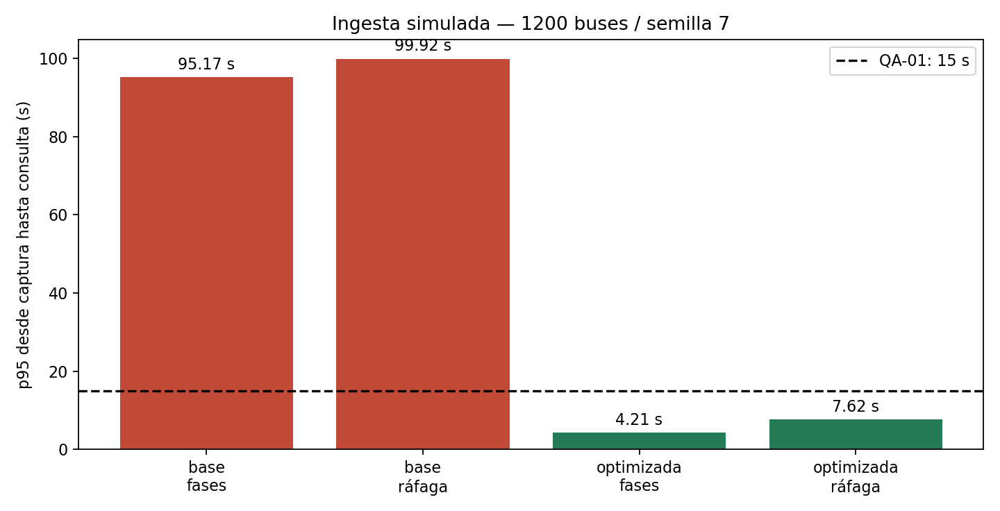

# E2 — Iteración ADD 1: ingesta y actualización del ETA

## 1. Revisar entradas

[Entradas](../entradas.md), QA-01/QA-03 del [árbol](../utilidad/escenarios.md),
ADR-001/002/003 y worker Celery del C4. R-01: un mes; R-02: tres desarrolladores;
R-03: un VPS. El servicio actual es un diseño y un esqueleto, no una plataforma
con latencias medidas; las cifras siguientes son hipótesis explícitas.

## 2. Elegir objetivo

QA-01 (H,H): 1200 buses/10 s = 120 eventos/s, p95 captura→ETA consultable ≤15 s.
Procesar todos los eventos del minuto antes de cierre+15 s. QA-03 amplía el
ensayo a 300/600/1200 buses. CPU <70% queda pendiente de medición real.

## 3. Elegir elemento a refinar

Worker ETA/Alertas y su acceso a rutas/paraderos. La ingesta REST mantiene la
cola Redis, el ID estable de ADR-003 y el despliegue del monolito modular.

## 4. Elegir conceptos de diseño

| Candidato | Mejora | Trade-off / costo relativo | Decisión |
|---|---|---|---|
| Precargar geometría por versión de ruta y reducir consultas repetidas | Menor trabajo por posición | RAM y obligación de refrescar geometría al editar rutas; esfuerzo medio, sin servicio pagado nuevo | Seleccionado como objetivo a validar |
| Aumentar workers sin cambiar trabajo por evento | Más concurrencia si hay I/O disponible | Compite con BD/API en 2 vCPU; no multiplica CPU; esfuerzo bajo pero capacidad incierta | Reserva condicionada a perfilado |
| Segundo VPS y partición de ingesta | Más recursos y aislamiento | Nuevo costo recurrente, operación y distribución; no respeta presupuesto actual sin aprobación | Rechazado para esta iteración |
| Microservicios + Kafka/Kubernetes | Partición y escalado independiente | Varias piezas operativas para equipo sin DevOps; costo alto dentro de un mes | Rechazado: falta evidencia que obligue a cambiar ADR-001 |

La selección es una hipótesis de diseño, no prueba de que un índice o una
precarga reales tengan exactamente el tiempo elegido.

## 5. Instanciar responsabilidades e interfaces

- API recibe evento con `bus_id`, ID estable y hora de captura; valida y encola.
- Worker obtiene geometría vigente, calcula con Strategy y guarda estado de
  lectura de ETA. Un cambio de ruta invalida la versión de geometría cargada.
- PostgreSQL conserva historial y último ETA por bus/paradero; el ID de evento
  protege contra repetición. Redis mantiene cola AOF y lectura de corto plazo.
- `RepositorioMemoria.guardar` demuestra rechazo de eventos duplicados,
  secuencias antiguas y retrocesos de timestamp; no demuestra durabilidad.
- El backlog se observa por edad máxima del evento y tiempo de drenaje. No se
  descartan posiciones para conseguir artificialmente la latencia objetivo.

## 6. Esbozar vistas y registrar decisiones

[ADR-006](../adr/006-ingesta.md), worker y BD marcados [QA-01, QA-03] en
[workspace.dsl](../c4/workspace.dsl). Se conservan los cuatro contenedores C4.

## 7. Analizar con evidencia

Ejecutable: `fitness/rendimiento.py::simular_ingesta`.
Dos servidores lógicos FCFS, 300 s, 36 000 eventos a 1200 buses; fases periódicas
uniformes o ráfaga de 1200 cada 10 s. Servicio lognormal de media **22 ms base** y
**6 ms optimizado**, sigma=0,35; hipótesis de I/O y trabajo reducido, no medición.
Se suman conservadoramente 200 ms de red, 2 s de TTL y 2 s de presupuesto API.
Esos son presupuestos **fijos del modelo**, no una demostración de que sumar
percentiles independientes dé el p95 del sistema completo. La latencia conjunta
de transporte, worker y API requiere una medición de extremo a extremo real.
Tres semillas (7, 19, 42). No hay caída de red, pérdida ni calentamiento de geometría
en este experimento. El p95 es rango más cercano, sin interpolación.

| Caso, semilla 7 | p95 total | Eventos ≤15 s | Pendientes a 300 s |
|---|---:|---:|---:|
| Base, fases distribuidas | 95,166 s | 11,24% | 8700 |
| Base, ráfaga sincronizada | 99,919 s | 6,30% | 8700 |
| Optimizado, fases distribuidas | 4,212 s | 100% | 0 |
| Optimizado, ráfaga sincronizada | 7,616 s | 100% | 0 |

La comprobación adicional de QA-01 cuenta los eventos que no están consultables
al cierre de cada minuto **más 15 s**. Con la optimización se obtienen
`[0, 0, 0, 0, 0]` tanto con fases distribuidas como sincronizadas; en la base
sin optimizar hay `[717, 2467, 4242, 5960, 7200]` para la ráfaga. El campo
`pendientes_al_cierre` de la tabla, en cambio, cuenta tareas del worker todavía
sin terminar a los 300 s: son medidas distintas.

Resultados completos: [tabla](../../../evidencias/resultados.md) y
[JSON](../../../evidencias/resultados.json). Capacidad teórica base 2/0,022 =
90,91 eventos/s <120; optimizada 333,33 eventos/s. Utilización 1,32 vs 0,36;
**estos números no son CPU**. FF-03 verifica cada semilla y los dos perfiles;
el control negativo sin optimización supera 15 s.

**Conclusión:** QA-01 cumple dentro del modelo optimizado. Al triplicar el servicio,
el p95 sube a 33,153 s: la decisión depende del costo real por evento. QA-03 solo
está parcialmente verificado hasta medir CPU/contención del VPS. Riesgos R1/R4;
no se afirma una garantía de producción.
