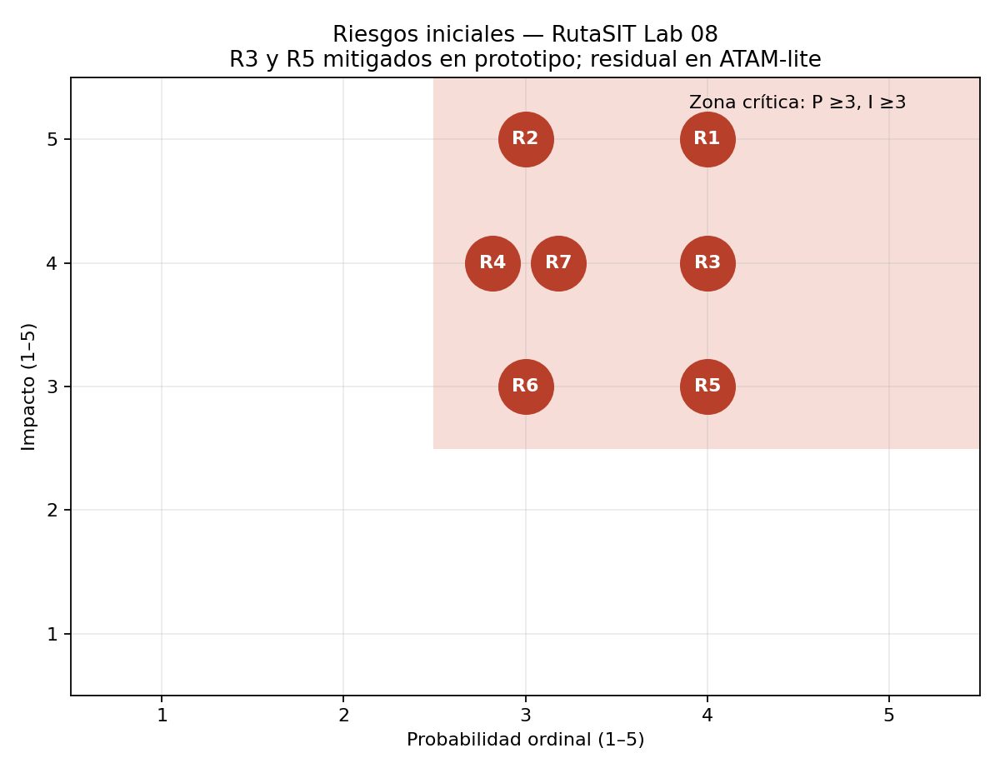

# E3/E7 — Evaluación ATAM-lite de RutaSIT

## Alcance y estado

Evaluación técnica propia, asistida por IA, del árbol, tres iteraciones ADD,
ADR-006/007/008, C4 y resultados ejecutados. Fecha: 2026-10-27.
Los tiempos de servicio son hipotéticos; los hallazgos no se extrapolan a producción.
**Evaluación cruzada externa pendiente**: al consultar todos los issues del
repositorio del grupo no se encontraron issues. Falta que el docente asigne el
otro repositorio y que ambos grupos publiquen/respondan su revisión.
La sección final y `revision-cruzada.md` preparan ese intercambio.

## Puntos de sensibilidad

| ID | Escenario | Parámetro / evidencia | Interpretación |
|---|---|---|---|
| S1 | QA-01/03 | Servicio del worker: 6→18 ms; ráfaga p95 7,616→33,153 s | El costo por evento domina la capacidad; worker no equivale a CPU libre |
| S2 | QA-04 | Servicio de consulta 25→37,5 ms: p95 pico frío 256,663→86 743,132 ms | Cerca de saturación, un 50% de error invalida la decisión |
| S3 | QA-04 | Solo caché, 80% aciertos: p95 pico 91 843,044 ms | Aciertos no sustituyen una consulta de respaldo eficiente |
| S4 | QA-02 | Espera del breaker 30 s; recuperación observada 2 s | Cambiar el intervalo altera recuperación y número de sondeos |
| S5 | QA-07 | Captura 29,5→30,5 s con TTL todavía vigente | La vigencia depende de fuente, no de hora de inserción en caché |

## Puntos de trade-off

| ID | Decisión | Mejora | Costo aceptado / respuesta |
|---|---|---|---|
| T1 | Geometría precargada por versión | Menos trabajo por posición | RAM y actualización coherente tras editar rutas; validar antes de desplegar |
| T2 | Read model + índice | Lecturas rápidas | Más trabajo/escrituras y espacio en PostgreSQL; medir carga mixta |
| T3 | Caché TTL 2 s | Menos lecturas repetidas | Hasta 2 s adicionales de antigüedad; validación por captura y FF-06 |
| T4 | Breaker 3/30 + fallback | 85,71 veces menos llamadas que reintentos; 0 vistas vacías | Mapa ausente y demora de sondeo; aviso explícito y estado textual |

## Riesgos, matriz y respuesta

Escala ordinal 1–5 (estimación de diseño, no probabilidad estadística).
Zona crítica: **P ≥3 e I ≥3**. P×I ayuda a ordenar; no representa pérdida monetaria.
El gráfico muestra valores iniciales. Se distingue mitigación ejecutada de trabajo pendiente.

| Riesgo | Escenarios | P | I | P×I | Pregunta incómoda | Mitigación / aceptación y estado |
|---|---|---:|---:|---:|---|---|
| R1 Hipótesis de servicio y recursos compartidos incorrectas | QA-01/03/04 | 4 | 5 | 20 | ¿Cuánto tarda realmente SQL y qué pasa al escribir y leer simultáneamente en 2 vCPU? | Sensibilidad ejecutada demuestra límite. Medir EXPLAIN ANALYZE y carga mixta; no cerrado. Las decisiones son condicionales; CPU <70% pendiente |
| R2 Falla del VPS único | QA-02/03 | 3 | 5 | 15 | ¿Qué información conserva un pasajero si también cae la API? | Aceptación propuesta durante MVP por R-03. Planificar copia externa y ensayo de restauración, no ejecutados aquí. Fallback de mapas no resuelve este riesgo |
| R3 ETA obsoleto servido desde caché | QA-07 | 4 | 4 | 16 | ¿Se comprueba captura o solo TTL? | Mitigado en iteración 2: edad de fuente en cada consulta, TTL 2 s, rechazo de desorden y pruebas. Residual propuesto P1/I4; reloj/distribución requieren prueba real |
| R4 Pérdida de posiciones o backlog tras reinicio Redis | QA-01/03 | 3 | 4 | 12 | ¿AOF y ACK aseguran exactamente qué ventana de pérdida? | AOF e IDs estables ya decididos en ADR-003; faltan ensayo de reinicio y protocolo ACK/reentrega. No se promete cero pérdida durable con memoria |
| R5 Tormenta de reintentos a mapas caídos | QA-02/04 | 4 | 3 | 12 | ¿Por qué repetir una petición a un proveedor que está caído 20 min? | Mitigado en iteración 3: 3600→42 llamadas, 0 vistas vacías. Residual P2/I2 en prototipo secuencial |
| R6 Breaker por instancia y sondeos concurrentes | QA-02 | 3 | 3 | 9 | ¿Qué pasa si diez procesos sondean al mismo tiempo? | No cubierto por el prototipo; adaptar bloqueo, timeout real y límite global antes de producción. Aceptado solo para experimento secuencial |
| R7 Ventana punta y popularidad desconocidas | QA-04 | 3 | 4 | 12 | ¿Las 50 000 consultas son por hora, por dos horas o una ráfaga de pocos minutos? | Supuesto de una hora explícito; ensayo ×5 y 0% aciertos ejecutados. Confirmar con docente/datos; no cerrado por simular un único perfil |

## No riesgos, limitados a evidencia disponible

- **NR1, QA-01:** el monolito no queda descartado automáticamente por 1200 buses:
  la tasa es 120 eventos/s, y el modelo optimizado satisface el p95 incluso con
  ráfagas. Esto no demuestra la capacidad de hardware real (R1).
- **NR2, QA-04:** una caché fría no rompe el presupuesto con servicio medio de
  25 ms y dos servidores en el modelo: 256,663 ms a 69,44 req/s. No se extiende
  a 37,5 ms ni a otras cargas.
- **NR3, QA-02/07:** las pruebas verifican que caída de mapas no elimina el estado
  textual, y que la vista no inventa ETA vigente cuando la fuente venció.
- **NR4, QA-06:** la prueba de extensión del Lab 07 sigue pasando con un algoritmo
  nuevo registrado sin modificar el servicio; la regresión del Lab 07 es
  30 passed y 1 xfailed preexistente.

## Falso positivo de la revisión adversarial con IA

**Hipótesis adversarial FP-01:** «50 000 consultas en hora punta equivalen a
50 000 solicitudes simultáneas; por ello el VPS debe reemplazarse por microservicios».

**Refutación:** la tabla 11 de la guía especifica volumen en hora punta, no
concurrencia. Bajo la ventana declarada de 3600 s, la tasa media es 13,89 req/s;
se ensayan 69,44 req/s para concentración. Volumen, tasa y concurrencia son
magnitudes distintas. La conclusión automática carece de evidencia. Se descarta
el hallazgo como falso positivo, manteniendo R7 por la distribución desconocida.
Es una hipótesis de esta revisión asistida, no una opinión recibida de otro grupo.

**FP-02:** «Cuatro contenedores C4 contradicen ADR-001 porque implican microservicios».
Se refuta con `lab06/docs/architecture/c4/workspace.dsl`: API, worker, BD y Redis
ya eran contenedores del monolito modular. C4 distingue unidades ejecutables;
una base de datos y un broker no son por eso servicios de negocio autónomos.

## Evaluación cruzada recibida — pendiente

| Dato | Estado |
|---|---|
| Grupo evaluador y autores | Pendiente asignación/intercambio |
| URL issue recibido | Pendiente |
| URL issue emitido al otro grupo | Pendiente |
| Hallazgos recibidos y respuestas fundamentadas | Pendiente; copiar literalmente y responder uno a uno |

Si el issue externo identifica un riesgo crítico, revisar las iteraciones 2/3
para mitigarlo según E4, regenerar evidencia y actualizar los ADR. No marcar E3
completo hasta tener ambos enlaces y respuestas.
