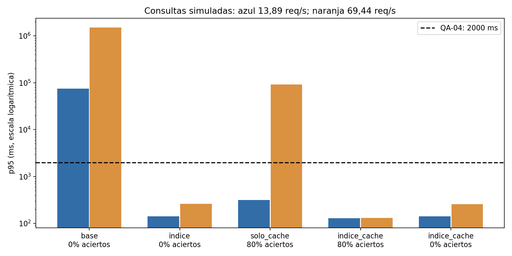
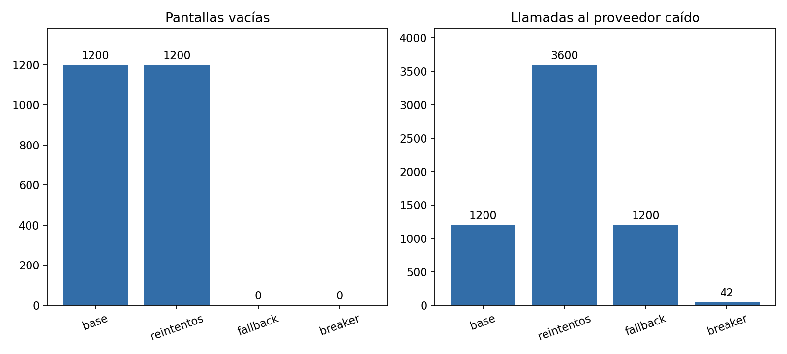
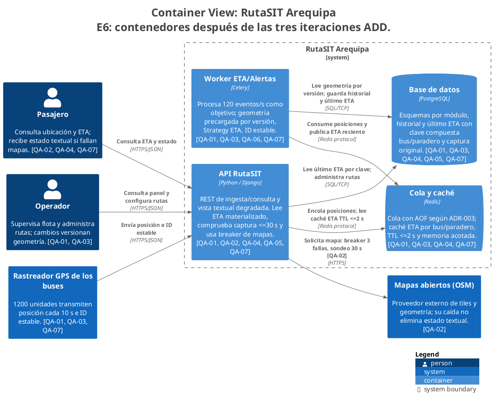

# Laboratorio 08 — Diseño de arquitectura guiado por atributos de calidad

**Caso:** RutaSIT Arequipa, Grupo B. **Asignatura:** Construcción de Software.
**Integrantes:** Layme Salas, Rodrigo Fabricio; Auccacusi Conde, Brayan Carlos;
Castillo Lazo, Rodrigo Zarun. **Docente:** Mg. Antonio Arroyo Paz.
**Periodo:** 2026-B, VI semestre. **Elaboración:** 27/10/2026.

## Resumen

Se propone la evolución de RutaSIT de 300 a 1200 buses y 50 000 consultas de ETA
en hora punta mediante tres iteraciones de Attribute-Driven Design (ADD 3.0).
Se conserva el monolito modular con Redis y PostgreSQL en un VPS, respetando
las decisiones del Lab 04 y la continuidad con UML, C4 y patrones de Labs 05–07.
El árbol contiene siete escenarios en cuatro atributos. Se ejecutaron simulaciones
de rendimiento, un prototipo de caché/frescura y un experimento de falla de mapas.
La configuración optimizada obtiene p95 de 7,616 s en ingesta sincronizada y
256,663 ms en consultas de pico con caché fría, bajo parámetros hipotéticos.
El breaker reduce llamadas al proveedor caído de 3600 a 42 y mantiene cero
respuestas sin estado textual. Pasan 24 pruebas y dos contratos estructurales.
La sensibilidad a tiempos de servicio impide afirmar capacidad real del VPS.

**Estado de entrega:** desarrollo y validación locales realizados. Faltan
ratificación de decisiones por el grupo, intercambio de issues E3, publicación,
Action remoto verde, PR revisados por integrante y etiqueta final. Este informe
no presenta esos actos colaborativos como ya realizados.

## I. Solución y resultados

### 1. Continuidad con los laboratorios anteriores

| Insumo | Origen | Aplicación |
|---|---|---|
| Requisitos y restricciones | Lab 04, `docs/architecture/drivers.md` | RF de GPS/ETA; tres desarrolladores, un mes, un VPS, sin datos personales del conductor |
| Monolito modular, BD y comunicación | ADR-001/002/003 | Mantener estilo, PostgreSQL por módulos, REST + cola Redis e IDs estables |
| HU-06, puertos y capas | Lab 05 | Vigencia de 30 s, lectura de seguimiento y dependencia hacia dentro |
| Fuente única C4 | Lab 06, `workspace.dsl` | API, worker, Redis y PostgreSQL, desplegados en un VPS |
| Patrones | Lab 07, ADR-005 | Strategy, Factory, Adapter y Decorator como puntos de extensión |

La tasa nueva es 1200/10 = **120 eventos GPS/s**. La guía no especifica duración
exacta de la punta ni concurrencia. Se asume una hora para las 50 000 consultas:
13,89 req/s, con ensayo de concentración ×5 (69,44 req/s). El Lab 04 identifica
una franja 6:30–8:30; interpretar las consultas en dos horas daría 6,94 req/s.
El supuesto elegido es explícito y conservador respecto a esa alternativa.

La latencia de actualización mide captura→ETA consultable; no es el valor de
minutos hasta llegada ni únicamente el tiempo HTTP. Se conserva el p95 ≤15 s;
se propone adicionalmente p95 de consulta ≤2 s. El objetivo de CPU <70% del
Lab 04 sigue pendiente de medición: utilización de cola no equivale a CPU.

### 2. E1 — Árbol de utilidad

Los escenarios completos de seis partes están en
`lab08/docs/architecture/utilidad/escenarios.md`. Se resumen a continuación.

| Escenario | Atributo | Importancia/dificultad | Medida |
|---|---|---|---|
| QA-01: ingesta de 1200 buses | Rendimiento | H,H | p95 captura→consulta ≤15 s; todos los eventos del minuto antes de cierre+15 s |
| QA-02: caída de mapas por 20 min | Disponibilidad | H,M | 0 vistas vacías; recuperación ≤300 s |
| QA-03: 300→600→1200 buses | Rendimiento/escalabilidad | H,H | p95 ≤15 s; CPU <70% pendiente |
| QA-04: consultas en punta y pico ×5 | Rendimiento | H,H | p95 ≤2000 ms con caché caliente/fría |
| QA-05: consulta pública | Seguridad | M,L | 0 campos personales en 100 respuestas |
| QA-06: nuevo algoritmo ETA | Modificabilidad | M,L | 0 líneas del servicio modificadas; prueba de extensión verde |
| QA-07: fuente obsoleta/desordenada | Disponibilidad/frescura | H,M | 0 ETA obsoletos como actuales; 0 reemplazos por eventos antiguos |

**Ejemplo completo QA-01:** fuente: 1200 buses; estímulo: envío cada 10 s;
entorno: hora punta con fases distribuidas o sincronizadas; artefacto: ingesta y
worker; respuesta: procesar y publicar ETA; medida: p95 ≤15 s y procesamiento
completo del minuto antes de cierre+15 s.

**Corrección de prioridad propuesta:** QA-05 pasa de la calificación inicial
H,H a M,L para el escenario acotado de exposición de datos: R-04 y HU-06 ya
excluyen información personal del conductor, y un DTO con campos permitidos
puede verificarse directamente. El equipo debe confirmar esta corrección;
no significa que toda la seguridad del sistema esté resuelta.

### 3. E2 — Primera iteración ADD: ingesta

| Paso ADD | Desarrollo |
|---|---|
| 1. Entradas | Drivers, QA-01/03, ADR-001/002/003 y worker del C4 |
| 2. Objetivo | Mantener p95 ≤15 s con 120 eventos/s |
| 3. Elemento | Worker ETA/Alertas y acceso a geometría de rutas |
| 4. Conceptos | Optimizar trabajo, más workers, segundo VPS, microservicios |
| 5. Responsabilidades | API encola, worker usa geometría versionada y publica ETA, BD conserva captura/ID |
| 6. Vistas/decisión | Worker y BD anotados QA-01/03; ADR-006 |
| 7. Análisis | Simulación antes/después, ráfagas y tres semillas; FF-03 |

Se selecciona reducir trabajo repetido y precargar geometría por versión.
Más workers se reserva para perfilado; segundo VPS y microservicios se rechazan
en esta iteración por costo/operación y ausencia de evidencia que los exija.
El trade-off es memoria e invalidación de geometría a cambio de menos trabajo.

**Supuestos:** dos servidores lógicos FCFS, 300 s, servicio lognormal sigma 0,35,
media base 22 ms y optimizada 6 ms; no medidos en el VPS. Se añaden 200 ms de
red, 2 s de TTL y 2 s de presupuesto API. Se prueban fases uniformes y ráfagas
de 1200 eventos cada 10 s, con semillas 7, 19 y 42. No se modelan reinicios ni
pérdida de red. El muestreo cada 10 s es anterior a la captura medida.

| Caso (semilla 7) | p95 extremo a extremo | Eventos dentro de 15 s | Pendientes a 300 s |
|---|---:|---:|---:|
| Base, fases | 95,166 s | 11,24% | 8700 |
| Base, ráfaga | 99,919 s | 6,30% | 8700 |
| Optimizado, fases | 4,212 s | 100% | 0 |
| Optimizado, ráfaga | 7,616 s | 100% | 0 |

La prueba adicional del escenario cuenta los eventos no consultables al
**cierre de cada minuto +15 s**: con ráfagas, la versión optimizada tiene
`[0, 0, 0, 0, 0]` y la base `[717, 2467, 4242, 5960, 7200]`. La columna
«pendientes a 300 s» mide únicamente el backlog del worker al acabar la
simulación; no se usa como sustituto de la medida por minuto.

La capacidad teórica base es 90,91 eventos/s, inferior a 120. Con 6 ms es
333,33 eventos/s. El modelo optimizado cumple QA-01, pero no prueba CPU real.
Triplicar el servicio produce p95 33,153 s y rompe el escenario. La evidencia
respalda una decisión condicionada a medir, no una garantía de despliegue.

### 4. E3 — Evaluación ATAM-lite

Se evaluaron los escenarios prioritarios con los cuatro tipos de hallazgo.

| Tipo | Hallazgo | Respuesta basada en evidencia |
|---|---|---|
| Sensibilidad | El p95 depende del servicio de consulta | Subir 25→37,5 ms causa 256,663→86 743,132 ms en pico frío |
| Trade-off | Caché reduce carga pero permite versiones anteriores | TTL máximo 2 s y validación del timestamp de captura |
| Riesgo R1 | Parámetros hipotéticos y competencia por el VPS | Prueba mixta/SQL pendiente; simulación de sensibilidad ejecutada |
| Riesgo R2 | VPS único | Aceptación propuesta para MVP por presupuesto; no resuelto por fallback |
| No riesgo acotado | Caché fría con servicio de 25 ms | 256,663 ms <2000 ms bajo ese modelo |

La revisión externa aún no ha sido recibida. Se preparó un guion para evaluar
el repositorio que asigne el docente: al menos una sensibilidad, un trade-off,
dos riesgos con P/I y un no riesgo. Se deben publicar y responder los issues,
copiar hallazgos y ajustar ADD si aparece un riesgo crítico. No se sustituyó
ese intercambio por la autoevaluación asistida.

### 5. E4 — Segunda iteración ADD: consultas y frescura

| Paso ADD | Desarrollo |
|---|---|
| 1. Entradas | QA-04/07, HU-06, PostgreSQL, Decorator y R-04 |
| 2. Objetivo | p95 consulta ≤2 s; nunca rejuvenecer una fuente >30 s |
| 3. Elemento | Read model de último ETA y puerto de lectura |
| 4. Conceptos | Solo caché, índice, índice+caché, réplica de lectura |
| 5. Responsabilidades | Worker materializa; API consulta por clave bus/paradero y comprueba fuente |
| 6. Vistas/decisión | API→Redis/BD y Worker→Redis/BD; ADR-007 |
| 7. Análisis | Ensayos frío/caliente, pico ×5, tres semillas, pruebas TTL/desorden |

Se selecciona último ETA indexado por bus/paradero más caché TTL 2 s. Se
rechaza caché sola como solución suficiente. La réplica externa queda diferida
por costo. El índice aumenta escrituras/espacio y la caché consume RAM; el
prototipo limita a 2400 entradas LRU y no cachea ausencias.

**Supuestos:** Poisson durante 300 s, dos servidores; medias lognormales
180 ms base, 25 ms índice/read model y 3 ms acierto, sigma 0,35. Se añaden
100 ms de transporte/serialización. Son hipótesis, no benchmark de SQL.

| Variante (semilla 7) | p95 a 13,89 req/s | p95 a 69,44 req/s |
|---|---:|---:|
| Base | 75 155,670 ms | 1 496 233,391 ms |
| Solo índice | 142,522 ms | 261,195 ms |
| Solo caché, 80% aciertos | 318,458 ms | 91 843,044 ms |
| Índice+caché, 80% | 128,900 ms | 130,788 ms |
| Índice+caché, fría (0%) | 142,757 ms | 256,663 ms |

FF-06 consulta una captura a los 29,5 s y a los 30,5 s. Aunque el TTL todavía
no venció, en el segundo caso se devuelve SIN_SEÑAL sin ETA actual. El read
model rechaza IDs repetidos/antiguos y timestamps que retroceden. La prueba de
seguridad verifica 100 respuestas con lista de campos de unidad permitidos.

### 6. E4 — Tercera iteración ADD: disponibilidad

| Paso ADD | Desarrollo |
|---|---|
| 1. Entradas | QA-02/07 y riesgo propio R5 de reintentos durante falla sostenida |
| 2. Objetivo | 0 vistas vacías; recuperar mapa ≤300 s; reducir llamadas ≥5 veces |
| 3. Elemento | Puerto Mapas y vista del pasajero |
| 4. Conceptos | Tres reintentos, solo fallback, breaker+fallback, segundo proveedor |
| 5. Responsabilidades | Breaker 3 fallas/30 s; consulta ETA independiente; estado textual con aviso |
| 6. Vistas/decisión | API→Mapas y componente Infraestructura anotados QA-02; ADR-008 |
| 7. Análisis | 1800 consultas con falla de 20 min; pruebas de apertura/reapertura/cierre |

Se rechazan tres reintentos como respuesta a una falla prolongada; solo fallback
conserva texto pero sigue golpeando al proveedor. Se elige breaker+fallback.
El costo aceptado es retrasar el sondeo de recuperación hasta 30 s y perder
temporalmente el mapa, informándolo explícitamente.

| Variante | Vistas vacías | Llamadas en caída | Recuperación |
|---|---:|---:|---:|
| Base acoplada | 1200 | 1200 | 0 s |
| Tres reintentos | 1200 | 3600 | 0 s |
| Solo fallback | 0 | 1200 | 0 s |
| Breaker+fallback | 0 | 42 | 2 s |

Se obtiene 85,71 veces menos llamadas que con reintentos. El experimento usa
reloj virtual, un cliente secuencial y timeout inyectado; no mide sockets ni
coordinación entre procesos. Se requieren timeout real y bloqueo de sondeos
antes de producción. Si también falta señal GPS se informa SIN_SEÑAL, sin
inventar datos recientes. El único VPS sigue siendo un punto de falla.

### 7. E5 — Fitness functions e integración continua

| Función | Verificación |
|---|---|
| FF-01 estructural | Capas internas no importan capas externas |
| FF-02 estructural | Aplicación/presentación no conocen adaptadores concretos |
| FF-03 calidad | p95 de ingesta ≤15 s y eventos a tiempo, fases/ráfagas |
| FF-04 calidad | p95 de consulta ≤2 s en pico con 0/20/80% aciertos |
| FF-05 calidad | Cero vistas vacías y protección del proveedor durante caída |
| FF-06 calidad | Captura obsoleta nunca se presenta como actual |
| FF-07 calidad | DTO de seguimiento sin datos personales del conductor |

**Resultado local:** 24 pruebas aprobadas y 2 contratos cumplidos. Además,
Lab 05 conserva 10 pruebas OK y Lab 07 conserva 30 passed, 1 xfailed preexistente.
En una rama Git de una copia temporal se introdujo dominio→aplicación (un
contrato roto) y aplicación→infraestructura (dos rotos); en ambos casos el
linter devolvió exit code 1. Tras `git restore`, volvió a 2 kept/0 broken.

El workflow `.github/workflows/fitness.yml` ejecuta las comprobaciones en cada
PR, conserva artefactos y valida/exporta C4. El estado remoto queda pendiente
de publicación. Bloquear merges exige configurar la comprobación como requerida
en protección de rama; el workflow solo no impone esa política.

### 8. E6 — ADR y C4 actualizado

| ADR | Decisión | Evidencia |
|---|---|---|
| 006 | Reducir trabajo por evento antes de distribuir ingesta | p95 99,919→7,616 s en modelo sincronizado |
| 007 | Read model indexado + caché breve y vigencia por captura | Pico frío 256,663 ms; prueba 29,5→30,5 s |
| 008 | Circuit breaker + vista textual | 0 vistas vacías; 42 llamadas en caída |

Los ADR usan contexto, alternativas, decisión y consecuencias de la plantilla
del Lab 04. Su estado indica selección para el prototipo y revisión humana
pendiente. C4 conserva cuatro contenedores, aumenta la flota a 1200 y etiqueta
elementos con escenarios. `structurizr validate` terminó con exit code 0 y se
exportaron cinco vistas a PlantUML y Mermaid, luego renderizadas a PNG/SVG.

El modelo describe el sistema objetivo Django/Celery/Redis/PostgreSQL. El
prototipo `rutasit8` verifica un corte de lectura y mapas en memoria; no se
presenta como un despliegue completo de esos contenedores.

### 9. E7 — Riesgos y uso crítico de IA

Zona crítica: probabilidad ≥3 e impacto ≥3, ambas escalas ordinales 1–5.

| Riesgo | P/I | Tratamiento |
|---|---|---|
| R1: servicio hipotético y recursos compartidos | 4/5 | Sensibilidad ejecutada; SQL/carga mixta pendientes |
| R2: falla del VPS único | 3/5 | Aceptación propuesta para MVP; plan de respaldo/restauración pendiente |
| R3: ETA obsoleto desde caché | 4/4 | Mitigado por fuente/TTL y pruebas; residual propuesto 1/4 |
| R4: reinicio/pérdida Redis | 3/4 | AOF e IDs heredados; prueba de durabilidad pendiente |
| R5: tormenta de reintentos | 4/3 | Breaker+fallback probado; residual secuencial 2/2 |
| R6: sondeos concurrentes | 3/3 | Bloqueo, timeout y alcance global pendientes |
| R7: ventana/distribución de punta | 3/4 | Hipótesis explícita, ensayo ×5 y confirmación pendiente |

La bitácora registra diez unidades de trabajo asistido: entradas heredadas,
priorización, tácticas de ingesta, caché, frescura, resiliencia, dos hipótesis
adversariales, separación de dependencias y verificación. Es un resumen de
elaboración, no una transcripción de reuniones ni una aprobación del equipo.

Se refuta el falso positivo **«50 000 consultas implican 50 000 simultáneas y
obligan a microservicios»**: la guía da volumen, no concurrencia, y la tasa bajo
una hora es 13,89 req/s. También se refuta que cuatro contenedores C4 contradigan
el monolito: el Lab 06 ya separaba API, worker, Redis y BD por unidades ejecutables.

### 10. E8 — Repositorio, revisión y entrega

Se agregó al README el árbol, tabla de iteraciones, ADR y badge. El repositorio
incluye instrucciones reproducibles, resultados JSON/Markdown, logs de pruebas,
diagramas y este informe editable. La colaboración restante se detalla en
`lab08/entrega.md`: revisar decisiones, completar E3, PR de cada integrante,
Action verde, tag `v0.8-arquitectura` y entrega antes del 31/10/2026 a las 23:59.
No se ha creado una revisión ni autoría ficticia para cumplir la rúbrica.

## II. Solución del cuestionario

### 1. ¿En qué se diferencia ADD de elegir un estilo como en el Lab 04?

El Lab 04 comparó estilos y fijó una estructura general bajo restricciones.
ADD revisa sistemáticamente esa arquitectura en iteraciones dirigidas por
escenarios: elige el elemento a refinar, compara tácticas, asigna responsabilidades,
actualiza vistas y mide. RutaSIT mantiene monolito modular, pero refina ingesta,
lectura y resiliencia con decisiones y evidencia específicas.

### 2. ¿Para qué sirven importancia/dificultad y cuál es la mayor prioridad?

Permiten invertir esfuerzo en lo que más valor aporta y mayor incertidumbre
técnica tiene. QA-01 es H,H y se atiende primero: si la telemetría de 1200 buses
no se procesa a tiempo, una consulta HTTP rápida solo entregaría información
vieja. QA-04 también es H,H y se aborda después para sostener la lectura en punta.

### 3. ¿Qué diferencia hay entre táctica y patrón? Ejemplo circuit breaker.

Una táctica modifica una respuesta de calidad, como detectar una falla o
prevenir que se propague. Un patrón organiza una solución recurrente que puede
combinar tácticas. Circuit breaker detecta errores y evita insistir al proveedor;
Decorator permite añadirlo alrededor del puerto Mapas sin modificar el caso de
uso. El fallback proporciona continuidad cuando el mapa no está disponible.

### 4. Describa sensibilidad y trade-off con evidencia.

Sensibilidad: al aumentar la media de consulta de 25 a 37,5 ms, el pico con caché
fría pasa de 256,663 a 86 743,132 ms de p95; la cola se satura. Trade-off: breaker
reduce llamadas durante la caída de 3600 a 42, pero la recuperación espera un
sondeo, observado a los 2 s y configurado con ventana de 30 s. Se intercambia
inmediatez de recuperación por protección del proveedor y de recursos locales.

### 5. ¿Qué supuestos pueden invalidar la decisión?

Se asumieron una hora de consultas, pico ×5, dos servidores por cola, medias
de servicio 22/6 ms para ingesta y 180/25/3 ms para lectura, y redes acotadas.
Las colas se ensayaron por separado, sin competencia real por disco/CPU.
Si la consulta tarda 50% más, el caso pico frío falla; si ingesta tarda triple,
falla QA-01. También pueden invalidar el diseño ráfagas mayores, pérdida de red,
otras cardinalidades de paraderos o competencia de PostgreSQL con el worker.
Se debe medir y recalibrar antes de afirmar capacidad de producción.

### 6. ¿Qué riesgo de la evaluación cruzada aceptaron sin mitigarlo?

Todavía no se recibió la evaluación externa, por lo que no corresponde inventar
un riesgo aceptado de ese intercambio. En el análisis propio se propone aceptar
R2, falla del VPS único, durante el MVP por el presupuesto y plazo de un mes.
Debe declararse el riesgo residual y planificarse respaldo/ensayo de restauración;
el fallback de mapas no resuelve la caída de la API. Esta respuesta se actualizará
con el hallazgo real y la decisión del grupo tras el intercambio E3.

### 7. ¿Qué es una fitness function y qué detecta cada una?

Es una comprobación automática de una propiedad arquitectónica que se repite
en CI para detectar degradación. FF-01 detecta inversión de capas; FF-02, fuga
de adaptadores al caso de uso; FF-03, incumplimiento de actualización; FF-04,
consulta lenta en pico/frío; FF-05, pérdida de fallback o protección externa;
FF-06, rejuvenecimiento de GPS obsoleto; FF-07, exposición de campos no permitidos.
Su alcance debe declararse: simulación y prototipo no reemplazan pruebas de
infraestructura real ni seguridad integral.

### 8. ¿Qué propuesta de IA rechazaron con evidencia y qué habría pasado?

Se descarta en la elaboración asistida que solo caché sea suficiente: con 80%
de aciertos en el pico, el p95 simulado es 91 843,044 ms. Adoptarla sin medir
habría dejado una consulta de respaldo saturable y una falsa sensación de
capacidad. También se refuta la equivalencia entre 50 000 consultas y 50 000
simultáneas; aceptarla habría inducido un cambio de estilo y costos no justificados.
Estas conclusiones y su evidencia quedan disponibles para ratificación humana.

## III. Conclusiones

1. Las tres iteraciones ADD refinan el monolito modular elegido en el Lab 04
   sin exigir microservicios: separan la ingesta, optimizan las consultas y
   aíslan el proveedor de mapas. Cada táctica responde a un escenario del árbol
   de utilidad y queda documentada en los ADR y las vistas C4.
2. Bajo los supuestos de la simulación, la ingesta optimizada reduce el p95 en
   ráfaga de 99,919 a 7,616 s y no deja eventos fuera del cierre de cada minuto
   +15 s. En consultas de pico con caché fría obtiene 256,663 ms de p95. Son
   resultados del modelo, no pruebas de capacidad del VPS: el análisis de
   sensibilidad muestra que un aumento del tiempo de servicio puede saturarlo.
3. El prototipo de mapas evita vistas sin estado textual ante la falla inyectada
   (1200 a 0) y reduce las llamadas al proveedor caído (3600 a 42). Las 24
   pruebas y los dos contratos de dependencia verifican comportamientos y
   límites arquitectónicos; no sustituyen mediciones ni pruebas de resiliencia
   en infraestructura real.
4. El árbol, las iteraciones, ADR, diagramas y evidencias permiten reproducir
   y discutir las decisiones. La aceptación final requiere ratificación del
   equipo, evaluación cruzada efectiva, PR revisados y un workflow remoto
   aprobado; esos pasos no se presentan como ya realizados.

## IV. Referencias y bibliografía

1. Bass, L., Clements, P. y Kazman, R. (2021). *Software Architecture in Practice*, 4.ª ed. Addison-Wesley.
2. Cervantes, H. y Kazman, R. (2016). *Designing Software Architectures: A Practical Approach*. Addison-Wesley.
3. Kazman, R., Klein, M. y Clements, P. (2000). *ATAM: Method for Architecture Evaluation*. CMU/SEI-2000-TR-004.
4. Ford, N., Parsons, R., Kua, P. y Sadalage, P. (2022). *Building Evolutionary Architectures*, 2.ª ed. O'Reilly.
5. Nygard, M. T. (2018). *Release It!*, 2.ª ed. Pragmatic Bookshelf.
6. Universidad Nacional de San Agustín (2026). Guías de laboratorio 04–08 de Construcción de Software. EPIS.
7. Grupo B (2026). Repositorio y reportes de RutaSIT, Labs 04–07. https://github.com/F4brici0L4yme/cs-2026b-lab04-grupo-b
8. Import Linter. Documentación de contratos. https://import-linter.readthedocs.io/
9. Structurizr. DSL y CLI. https://docs.structurizr.com/dsl
10. PostgreSQL. Índices. https://www.postgresql.org/docs/current/indexes.html
